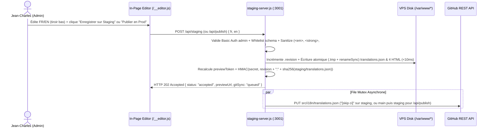

# Architecture Spine — Éditeur Client Bilingue In-Page (SDRnow)

## Design Paradigm

**Static Prod / Gatekept Staging Proxy**

- **Production (`sdrnow.fr` $\rightarrow$ `/var/www/html`)** : Servie directement par le `file_server` statique de Caddy, sans aucune dépendance au processus Node.js.
- **Staging (`staging.sdrnow.fr` $\rightarrow$ `127.0.0.1:3001` $\rightarrow$ `/var/www/staging`)** : Caddy assure uniquement la terminaison TLS et délègue par `reverse_proxy` au micro-service Node.js (`infra/staging-server.js`, exécuté sous `User=caddy`). Ce micro-service contrôle l'accès (Basic Auth `admin` vs jeton Read-Only `?preview=`), injecte à la volée le script d'édition `/__editor.js` uniquement pour `admin`, patche atomiquement les 4 fichiers HTML compilés sur disque en moins de 10 ms, et synchronise `src/i18n/translations.json` vers GitHub en file d'attente asynchrone (`HTTP 202 Accepted`).

## Inherited Invariants

| Inherited | From parent | Binds here |
| --- | --- | --- |
| AD-1 (Pas de Docker / Direct Packages) | `architecture-sdrnow-infra` | Le micro-service Node.js est installé et supervisé nativement via `cloud-init.yaml`, `.github/workflows/deploy.yml` et `systemd` sans Docker. |
| AD-2 (Caddy comme Serveur Web) | `architecture-sdrnow-infra` | Caddy sert directement `/var/www/html` en prod et agit comme reverse-proxy TLS devant `127.0.0.1:3001` sur `staging.sdrnow.fr`. |
| AD-3 (Déploiement Zero-Touch & Reproductibilité Git) | `architecture-sdrnow-infra` | Toute mutation locale de texte sur le VPS est répercutée par commit automatique dans GitHub (`src/i18n/translations.json`) afin qu'un redéploiement CI/CD ou OpenTofu reconstruise l'état exact. |

## Invariants & Rules

```mermaid
flowchart LR
    AstroBuild["Astro Build (src/components + src/i18n/translations.json)"] --> StaticBundles["Static Bundles (/var/www/staging & /var/www/html)"]
    Caddy["Caddy Web Server"] -->|file_server| StaticBundles
    Caddy -->|reverse_proxy staging.sdrnow.fr| StagingSrv["Staging Micro-service (infra/staging-server.js)"]
    StagingSrv -->|read / atomic patch| StaticBundles
    StagingSrv -->|injects for admin only| EditorJS["In-Page Editor (infra/editor-client.js)"]
    EditorJS -->|GET /api/translations & POST /api/*| StagingSrv
    StagingSrv -->|async mutex PUT [skip ci]| GitHubAPI["GitHub REST API (branches staging & main)"]
```

### AD-4 — Séparation Stricte Prod Statique vs Proxy Staging [ADOPTED]

- **Binds:** CAP-1, CAP-3, CAP-4, AD-2
- **Prevents:** Couplage de la disponibilité de `sdrnow.fr` au démon Node.js ou fuite du code d'administration dans le HTML de production.
- **Rule:** `sdrnow.fr` est servi exclusivement par `file_server` dans Caddy sur `/var/www/html` sans script d'édition dans le HTML compilé par Astro. `staging.sdrnow.fr` retire son bloc `basicauth` Caddy et route tout le trafic via `reverse_proxy 127.0.0.1:3001` vers `infra/staging-server.js`, qui injecte `<script src="/__editor.js"></script>` juste avant `</body>` uniquement lorsque la requête est authentifiée en tant qu'`admin`.

### AD-5 — Runtime Node 20 Zéro-Dépendance, Unité Sémantique & Feuilles DOM [ADOPTED]

- **Binds:** CAP-1, CAP-2, CAP-3, CAP-4, CAP-5, AD-1
- **Prevents:** Déploiement d'un `node_modules` sur le VPS Scaleway, découpage artificiel d'une phrase en plusieurs clés pour le style, omission de nœuds conditionnels, ou corruption du DOM lors du patch HTML.
- **Rule:**
  1. `infra/staging-server.js` utilise exclusivement les modules natifs de Node.js 20 (`node:http`, `node:fs`, `node:path`, `node:crypto`, `fetch`).
  2. Chaque unité de sens grammaticale constitue une clé unique dans `src/i18n/translations.json` (`hero.title_pre` et `hero.title_highlight` sont fusionnés en `hero.title` ; il est interdit de scinder une phrase en éléments `[data-i18n]` frères pour appliquer un style). Les URLs structurelles (`footer.phone_href`, `footer.legal_href`) restent dans le code des composants hors de `translations.json`.
  3. Tout élément portant `data-i18n="<key>"` est une feuille sémantique (`h1`–`h3`, `p`, `span`, `li`, `a`, `div`, `title`) rendue **inconditionnellement** dans le HTML compilé (même si sa valeur est `""`, comme `pricing.strategy_unit`), portant `data-i18n-type="plain|rich"`, et ne contenant jamais d'élément enfant `[data-i18n]` ni de balise autre que `<em>`, `<strong>` et `<br>`. Dans `Footer.astro` et `mentions-legales.astro`, les libellés accompagnés d'un lien `<a>` sont isolés dans leur propre `<span data-i18n="..." data-i18n-type="plain">`. Dans `Layout.astro`, `<title>` porte `data-i18n="meta.title"` (ou `meta.legal_title`) et `<meta name="description">` porte `data-i18n-content="meta.description"`.
  4. Côté client (`infra/editor-client.js`), l'éditeur s'affiche dans un tiroir flottant en bas d'écran (`position: fixed; bottom: 0; left: 0; right: 0`) préservant 100 % de la largeur du viewport ; le focus dans le champ FR ou EN permute instantanément tous les nœuds `[data-i18n]` de la page dans la langue active sans rechargement.

### AD-6 — Mutation Locale Atomique (`< 10 ms`) & File d'Attente Git `202 Accepted` [ADOPTED]

- **Binds:** CAP-3, CAP-4, CAP-5, AD-3
- **Prevents:** Latence réseau GitHub bloquante au clic, erreurs `EACCES` sur `/var/www/`, conflits HTTP `409` sur l'API GitHub lors de sauvegardes rapprochées, désynchronisation entre `main` et `staging`, et *race condition* d'écrasement par `.github/workflows/deploy.yml`.
- **Rule:**
  1. Le build (`npm run build` / `deploy.yml`) copie `src/i18n/translations.json` dans `dist/translations.json` afin que `/var/www/staging/translations.json` et `/var/www/html/translations.json` soient toujours présents sur disque. Le service `sdrnow-staging.service` s'exécute sous `User=caddy` et `Group=caddy`, propriétaire de `/var/www/staging`, `/var/www/html` et `/etc/sdrnow/staging.env` (`0600`).
  2. Les 4 fichiers HTML patchés dans chaque répertoire cible sont exactement : `index.html` (`fr`), `en/index.html` (`en`), `mentions-legales/index.html` (`fr`), et `en/legal-notice/index.html` (`en`).
  3. Comportement des routes de mutation :
     - `POST /api/staging` (corps `{"fr": {...}, "en": {...}}`) : valide et nettoie les valeurs en conservant l'objet `schema` serveur, incrémente le compteur monotone `/var/www/staging/.revision`, écrit atomiquement (`.tmp` + `fs.renameSync`) `translations.json` et les 4 fichiers HTML dans `/var/www/staging` en `< 10 ms`, retourne `HTTP 202 Accepted`, et enfile un commit `[skip ci]` de `src/i18n/translations.json` sur la branche `staging`.
     - `POST /api/publish` (corps `{"fr": {...}, "en": {...}}`) : valide et nettoie les valeurs, incrémente `/var/www/staging/.revision`, écrit atomiquement `translations.json` et les 4 fichiers HTML dans `/var/www/html` **et** `/var/www/staging` en `< 10 ms`, retourne `HTTP 202 Accepted`, et enfile un commit `[skip ci]` de `src/i18n/translations.json` séquentiellement sur les branches **`main` puis `staging`**.
     - `POST /api/reset` (corps vide `{}`) : lit `/var/www/html/translations.json`, incrémente `/var/www/staging/.revision`, écrit atomiquement `translations.json` et les 4 fichiers HTML dans `/var/www/staging` en `< 10 ms` (sans toucher à `/var/www/html`), retourne `HTTP 202 Accepted`, et enfile un commit `[skip ci]` sur la branche `staging`.
  4. Tous les commits GitHub passent par une file séquentielle (mutex en mémoire) qui récupère le `sha` courant du fichier sur la branche cible avant le `PUT /repos/:owner/:repo/contents/src/i18n/translations.json` et effectue 1 retry automatique en cas de `409 Conflict`.

### AD-7 — Double Porte d'Accès Staging & Jeton Read-Only Monotone par Révision [ADOPTED]

- **Binds:** CAP-1, CAP-3, CAP-5
- **Prevents:** Exposition publique de `staging.sdrnow.fr`, crash `RangeError` sur `timingSafeEqual`, apparition d'une popup Basic Auth chez un relecteur dont le lien a expiré, ou réactivation d'un ancien lien après un `reset` ($A \to B \to A$).
- **Rule:** Le jeton de prévisualisation actif est défini par `previewToken = HMAC-SHA256(STAGING_PREVIEW_SECRET, revision + ":" + sha256(staging/translations.json))` où `revision` est l'entier monotone stocké dans `/var/www/staging/.revision`. Toute requête sur `staging.sdrnow.fr` est évaluée dans cet ordre :
  1. **Porte Admin (Basic Auth)** : Si l'en-tête `Authorization: Basic` est présent et que `SHA-256(user)` et `SHA-256(pass)` (buffers de 32 octets) correspondent via `crypto.timingSafeEqual` à `SHA-256(ADMIN_USER)` et `Buffer.from(ADMIN_PASS_SHA256, 'hex')` $\rightarrow$ sert le HTML avec injection de `<script src="/__editor.js"></script>` et autorise `GET /api/translations` ainsi que `POST /api/*`.
  2. **Porte Read-Only (Query `?preview=` prioritaire sur Cookie)** :
     - Si le paramètre d'URL `?preview=<token>` est présent : s'il correspond au `previewToken` actif, dépose `Set-Cookie: staging_preview=<token>; Path=/; HttpOnly; Secure; SameSite=Lax` et sert les ressources `GET`/`HEAD` sans `/__editor.js` (tout appel `/api/*` renvoie `403 Forbidden`). S'il est invalide ou expiré, renvoie immédiatement **`403 Forbidden`** (page HTML « Lien de prévisualisation expiré », **sans** en-tête `WWW-Authenticate`) afin de ne jamais déclencher de popup Basic Auth chez un relecteur.
     - Sinon, si le cookie `staging_preview=<token>` est présent et correspond au `previewToken` actif $\rightarrow$ sert les ressources `GET`/`HEAD` en lecture seule sans `/__editor.js` (et `403 Forbidden` sur `/api/*`).
  3. **Défaut** : Toute autre requête (sans `?preview=` et sans session valide) reçoit `401 Unauthorized` avec `WWW-Authenticate: Basic realm="SDRnow Staging Admin"`.

### AD-8 — Contrat Sémantique HTML5 & Sanitization par Whitelist [ADOPTED]

- **Binds:** CAP-2, CAP-4
- **Prevents:** Injection XSS, introduction de classes CSS ou de `<span>` dans `translations.json`, perte de contraste sur fond orange, et publication de blocs vides.
- **Rule:** Le schéma des clés, leur caractère obligatoire/optionnel (`pricing.strategy_unit` seul optionnel) et leur type (`plain` vs `rich`) sont définis dans l'objet `schema` de `src/i18n/translations.json`. Tant à l'insertion presse-papier côté client (`paste` forcé en `text/plain`) qu'à la validation serveur sur `POST /api/staging` et `POST /api/publish` :
  - Toute clé inconnue, manquante ou dont la valeur nettoyée (texte hors balises) est vide sur une clé obligatoire entraîne un rejet `400 Bad Request`.
  - Sur les clés `plain`, toute balise HTML et tout saut de ligne sont supprimés (les boutons de formatage et la touche `Entrée` sont désactivés dans l'éditeur).
  - Sur les clés `rich`, seules les balises `<em>`, `<strong>` et `<br>` (sans aucun attribut) sont conservées ; toute autre balise est purgée en ne gardant que son texte.
  - En CSS, `<em>` est stylé en `[&_em]:text-primary [&_em]:not-italic` sur fond clair, et bascule en `[&_em]:underline [&_em]:decoration-white [&_em]:not-italic` dans les conteneurs à fond `bg-primary` (`Pricing.astro` H2).

## Consistency Conventions

| Concern | Convention |
| --- | --- |
| Naming (fichiers, attributs, routes) | Source i18n : `src/i18n/translations.json` (copiée vers `dist/translations.json`). Attributs DOM : `data-i18n="<key>"`, `data-i18n-type="plain\|rich"`, et `data-i18n-content="meta.description"`. Routes API : `GET /api/translations`, `POST /api/staging`, `POST /api/publish`, `POST /api/reset`. |
| Data & formats (JSON i18n, payloads, réponses) | `translations.json` : `{"schema": {"hero.title": {"type": "rich", "optional": false}, ...}, "fr": {...}, "en": {...}}`. `GET /api/translations` renvoie `200 OK` avec `{"schema", "fr", "en", "previewUrl"}`. `POST /api/staging` et `/api/publish` reçoivent `{"fr", "en"}`. `POST /api/reset` reçoit `{}`. Réponse des `POST /api/*` : `202 Accepted` avec `{"status": "accepted", "previewToken": "<hmac>", "previewUrl": "https://staging.sdrnow.fr/?preview=<hmac>", "gitSync": "queued"}`. Erreurs : `{"error": "<code_court>", "message": "<détail>"}`. |
| State & cross-cutting (systemd, permissions, secrets) | Service `sdrnow-staging.service` exécuté sous `User=caddy` / `Group=caddy`. Fichier `/etc/sdrnow/staging.env` (`0600`, `caddy:caddy`) provisionné par `deploy.yml` avec : `ADMIN_USER`, `ADMIN_PASS_SHA256` (hex SHA-256 64 caractères), `STAGING_PREVIEW_SECRET`, `GITHUB_PAT`, `GITHUB_REPO`. `deploy.yml` installe de façon idempotente Node.js 20 LTS et l'unité systemd via SSH (en complément de `cloud-init.yaml`, car `infra/main.tf` applique `ignore_changes = [user_data]`). |

## Stack

| Name | Version |
| --- | --- |
| Astro | ^5.4.2 |
| @astrojs/tailwind | ^5.1.5 |
| Tailwind CSS | ^3.4.17 |
| Node.js | 20 LTS |
| Caddy | 2.x (stable) |
| OpenTofu | 1.x (latest) |
| Scaleway OS | Ubuntu 22.04 LTS (ubuntu_jammy) |

## Structural Seed

**Deployment & Request Topology**

```mermaid
flowchart TD
    subgraph Public ["Visiteurs Publics"]
        V["Navigateur Client"]
    end
    subgraph Reviewers ["Relecteurs (Avis)"]
        R["Navigateur (?preview=hmac)"]
    end
    subgraph AdminUser ["Jean-Charles (Admin)"]
        A["Navigateur (Basic Auth admin)"]
    end

    subgraph VPS ["VPS Scaleway (Caddy + systemd User=caddy)"]
        Caddy["Caddy (443 TLS)"]
        ProdFS["/var/www/html (4 HTML + translations.json)"]
        StagingSrv["sdrnow-staging.service (Node 20 :3001)"]
        StagingFS["/var/www/staging (4 HTML + translations.json + .revision)"]
    end

    subgraph GitHub ["GitHub"]
        Repo["Repo sdrnow (branches: staging, main)"]
    end

    V -->|HTTPS sdrnow.fr| Caddy
    Caddy -->|file_server| ProdFS

    R -->|HTTPS staging.sdrnow.fr/?preview=hmac| Caddy
    A -->|HTTPS staging.sdrnow.fr| Caddy
    Caddy -->|reverse_proxy 127.0.0.1:3001| StagingSrv
    StagingSrv -->|Read / Atomic Patch <10ms| StagingFS
    StagingSrv -->|Atomic Patch <10ms on /api/publish| ProdFS
    StagingSrv -->|Async Mutex PUT [skip ci]| Repo
```

**State Mutation & Git Synchronization Sequence**



**Minimal Source Tree**

```text
/
  .github/workflows/
    deploy.yml                 # CI/CD : build Astro + copie translations.json, installe Node 20/systemd, déploie dist/
  infra/
    Caddyfile.template         # sdrnow.fr -> file_server ; staging.sdrnow.fr -> reverse_proxy 127.0.0.1:3001
    cloud-init.yaml            # Cold-start : installe Caddy + Node.js 20 et prépare /etc/sdrnow
    main.tf                    # Infrastructure OpenTofu Scaleway (ubuntu_jammy)
    staging-server.js          # Micro-service Node 20 (auth, patch 4 HTML <10ms, API 202, file Git [skip ci])
    editor-client.js           # Script client servi sur /__editor.js (tiroir FR/EN, switch langue, appels API)
    sdrnow-staging.service     # Unité systemd (User=caddy) supervisant staging-server.js
  package.json                 # Scripts build Astro + copie de src/i18n/translations.json vers dist/
  src/
    components/                # Composants Astro annotés data-i18n et data-i18n-type="plain|rich"
    i18n/
      translations.json        # Source de vérité unique des textes FR/EN et du schéma plain/rich
      translations.ts          # Chargeur typé lisant translations.json au build Astro
    layouts/
      Layout.astro             # Porte data-i18n sur <title> et data-i18n-content sur <meta name="description">
    pages/
      index.astro              # Accueil FR (/)
      mentions-legales.astro   # Mentions légales FR (/mentions-legales)
      en/
        index.astro            # Accueil EN (/en)
        legal-notice.astro     # Mentions légales EN (/en/legal-notice)
```

## Capability → Architecture Map

| Capability / Area | Lives in | Governed by |
| --- | --- | --- |
| CAP-1 (Édition bilingue In-Page & Preview CSS pleine largeur) | `infra/editor-client.js`, `src/components/*.astro`, `src/i18n/translations.json` | AD-4, AD-5 |
| CAP-2 (Formatage sémantique bridé `<em>`/`<strong>`/`<br>` & `plain` vs `rich`) | `infra/editor-client.js`, `infra/staging-server.js`, `src/i18n/translations.json` | AD-5, AD-8 |
| CAP-3 (Enregistrement Staging `< 10 ms` & Lien Read-Only par révision) | `infra/staging-server.js`, `infra/Caddyfile.template` | AD-4, AD-6, AD-7 |
| CAP-4 (Publication directe en Production & Synchro Git `[skip ci]`) | `infra/staging-server.js`, `.github/workflows/deploy.yml` | AD-3, AD-4, AD-6, AD-8 |
| CAP-5 (Réinitialisation du Staging depuis la Production) | `infra/staging-server.js`, `infra/editor-client.js` | AD-6, AD-7 |

## Deferred

- **Historique multi-versions dans l'UI (Rollback au-delà de la Prod courante) :** Non requis ; `POST /api/reset` couvre le retour à l'état Prod courant, et l'historique complet reste disponible dans le log Git de `src/i18n/translations.json`.
- **Édition multi-utilisateurs concurrente (verrous optimistes entre plusieurs admins) :** Non requis ; Jean-Charles est l'unique détenteur du compte `admin`.
